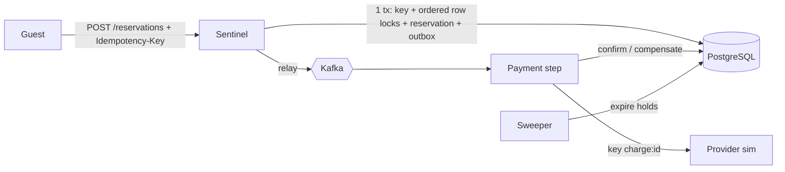

# Sentinel — Inventory & Reservation Engine

A hotel reservation engine that **cannot oversell**, survives client retries and process crashes, and
completes payment through an orchestrated saga with compensation. PostgreSQL is the single source of
truth; Kafka carries reservation events through a transactional outbox; a deterministic payment
simulator injects declines, outages and ambiguous timeouts on demand.

Java 21 · Spring Boot 3.5 · PostgreSQL 16 · Kafka (KRaft) · Docker Compose · Testcontainers ·
GitHub Actions · Prometheus/Grafana · Python tooling



Design document: [`docs/ARCHITECTURE.md`](docs/ARCHITECTURE.md) ·
API: [`docs/API.md`](docs/API.md) ·
Concurrency evidence: [`docs/CONCURRENCY_EVIDENCE.md`](docs/CONCURRENCY_EVIDENCE.md)

## Engineering highlights

- **No oversell, by construction.** Nights are locked with `SELECT … ORDER BY stay_date FOR UPDATE`
  (deterministic order ⇒ no deadlocks between overlapping stays), checked, then decremented. A
  `CHECK (reserved <= total)` constraint is the backstop.
- **Verified with a negative control.** A database-level concurrency check runs the production SQL from
  32 concurrent connections and confirms the invariants. The same checker catches a naive implementation
  that accepted 356 reservations against 10 rooms per night without ever tripping the CHECK constraint.
- **Idempotency keys done properly.** Stored in PostgreSQL in the same transaction as the booking;
  concurrent duplicates are serialized by the unique index; key reuse with a different body → 422.
- **Transactional outbox + idempotent consumers.** Events commit with state; consumers deduplicate with
  `processed_events`; every provider call carries an idempotency key.
- **Saga with compensation.** Decline → release rooms. Capture after expiry → refund. Provider timeout →
  retry with the same key (no double charge). Provider down → hold expiry + reconciliation converge.
- **Exactly-once release.** An explicit `holds_inventory` flag means cancel, expiry and payment failure
  can race and rooms are still returned exactly once.

## Status — what is verified and what is not

| Area | Status | Evidence |
|---|---|---|
| Schema (Flyway V1) | ✅ Executed | Applied to PostgreSQL 16.15 |
| Reservation SQL under concurrency: no oversell, no drift, no deadlocks, idempotent retries, negative control detected | ✅ Executed | `tools/sql_concurrency_check.py` → [`reports/sql-concurrency.json`](reports/sql-concurrency.json), summarized in [`docs/CONCURRENCY_EVIDENCE.md`](docs/CONCURRENCY_EVIDENCE.md) |
| Inventory upsert, drift audit query, CHECK on shrink, guarded payment status transitions | ✅ Executed | Run directly on PostgreSQL 16.15 |
| Docker Compose file | ✅ Validated | `docker compose config` (stack not started) |
| Java application (API, idempotency, state machine, outbox relay, payment saga, sweeper, reconciler) | 🟡 Implemented, **not yet compiled** | Build environment had no access to Maven Central |
| Java tests: 1 unit class, 3 integration classes (HTTP-level concurrency, idempotency, 7 saga/failure-injection scenarios) | 🟡 Written, **not yet executed** | Same reason; they run in CI (`mvn verify`) |
| Reservation load generator (`tools/sentinel_loadtest.py`) | 🟡 Written, syntax-checked, not yet run against the service | |
| GitHub Actions CI | 🟡 Written, not yet run | Requires pushing to GitHub |
| Performance results | ⬜ **None recorded** | No throughput/latency numbers are claimed |

### Features

| Feature | State |
|---|---|
| Hotels, room types, per-night inventory and price (admin API) | Implemented |
| Lock-free availability read | Implemented |
| Reservation creation with ordered row locking + CHECK backstop | Implemented |
| Cancellation (idempotent), with refund of captured payments | Implemented |
| Idempotency keys (same-tx, hash check, concurrent-safe) | Implemented |
| Transactional outbox + relay (SKIP LOCKED) | Implemented |
| Kafka event publishing, consumer dedup, retry + DLT | Implemented |
| Simulated payment provider with failure injection | Implemented |
| Saga compensation (decline, late capture, cancel-after-confirm) | Implemented |
| Hold expiry sweeper, payment reconciler | Implemented |
| Inventory invariant audit endpoint | Implemented |
| Guest authentication, per-client key scoping | Not implemented |
| Distributed tracing | Not implemented |
| Hot-row mitigation (admission queue) | Not implemented |
| Scheduled idempotency-key cleanup | Partially (repository method exists, not scheduled) |

## Run it

```bash
cp .env.example .env              # set real values; .env is git-ignored
docker compose up -d --build      # postgres, kafka, sentinel on :8081
docker compose --profile observability up -d    # Prometheus :9091, Grafana :3001
```

Walkthrough (see `docs/API.md` for full examples):

```bash
KEY=...   # SENTINEL_ADMIN_API_KEY
RT=$(curl -s -X POST localhost:8081/api/v1/admin/hotels -H "X-Api-Key: $KEY" -H 'Content-Type: application/json' \
      -d '{"name":"Demo","roomTypes":[{"name":"Deluxe","maxGuests":2}]}' | python3 -c 'import sys,json;print(json.load(sys.stdin)["roomTypes"][0]["roomTypeId"])')
curl -s -X PUT localhost:8081/api/v1/admin/room-types/$RT/inventory -H "X-Api-Key: $KEY" -H 'Content-Type: application/json' \
      -d '{"from":"2027-03-01","to":"2027-03-10","total":2,"price":"150.00","currency":"USD"}'
curl -s -X POST localhost:8081/api/v1/reservations -H "Idempotency-Key: demo-1" -H 'Content-Type: application/json' \
      -d "{\"roomTypeId\":\"$RT\",\"checkIn\":\"2027-03-01\",\"checkOut\":\"2027-03-03\",\"rooms\":1,\"guestName\":\"Ada\",\"guestEmail\":\"ada@example.com\",\"paymentToken\":\"tok_ok\"}"
```

## Test

```bash
mvn verify                                              # unit + integration (Testcontainers: needs Docker)
python3 tools/sql_concurrency_check.py --dsn postgresql://postgres@localhost:5432/sentinel_check
```

Without Docker: `SENTINEL_IT_EXTERNAL=true SENTINEL_IT_DB_URL=jdbc:postgresql://localhost:5432/sentinel_it SENTINEL_IT_DB_USER=postgres mvn verify`.

## Benchmarks

```bash
python3 tools/sentinel_loadtest.py --scenario flash-sale --rooms 50 --concurrency 32 --duration 30 --out reports/flash.json
python3 tools/sentinel_loadtest.py --scenario spread --room-types 200 --concurrency 32 --duration 60 --out reports/spread.json
```

Each report includes latency percentiles, status counts, unexpected-error rate and the post-run inventory
audit result. **No results recorded yet.**

## Layout

```
src/main/java/com/sentinel/reservation/
  inventory/    inventory SQL (ordered locks), admin + availability API, audit
  reservation/  state machine service, idempotency, API, hold expiry sweeper
  payment/      provider port, simulator, saga step (consumer), reconciler
  outbox/       outbox writer, relay
  config/       properties, Kafka, errors, API key
tools/          SQL concurrency check (+ negative control), load generator
```
