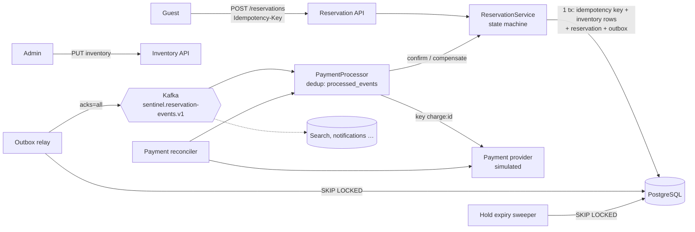
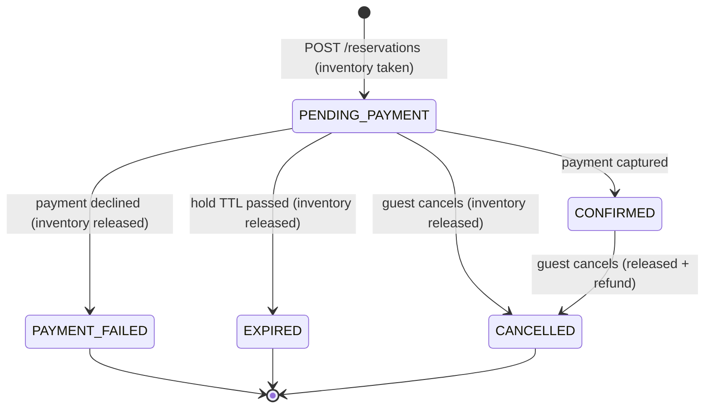
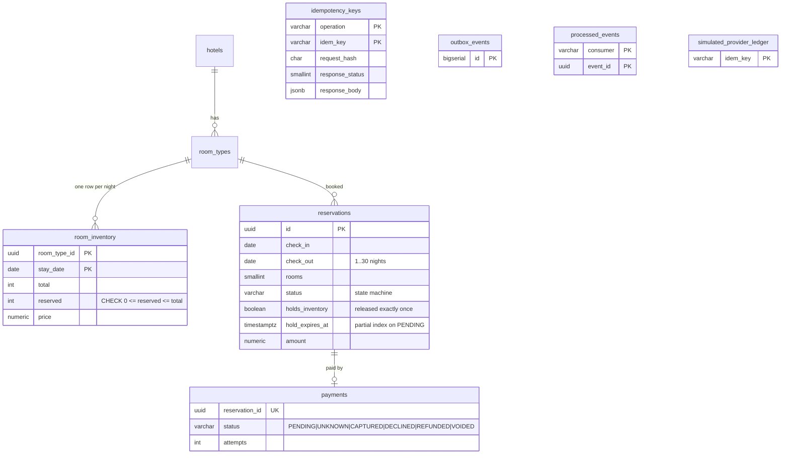

# Sentinel — Engineering Design Document

## 1. Problem

Sell hotel rooms night by night without ever selling a room twice, while:
- clients retry requests (timeouts, flaky mobile networks) and must not create duplicate bookings;
- payment is an external, slow, sometimes ambiguous dependency (a timeout may or may not have charged);
- every state change must be announced to other systems (search, notifications, finance) reliably;
- any process may crash at any point.

**Non-goals:** pricing/yield management, multi-property carts, overbooking policies, real payment
integration (a deterministic simulator stands in for the provider).

## 2. Architecture

One Spring Boot service, one PostgreSQL database, one Kafka topic. The saga is **orchestrated inside the
service**: splitting "inventory", "reservation" and "payment" into separate services would replace local
ACID transactions with distributed coordination and buy nothing at this scale.



### Why each technology is here

| Component | Why | Not used for |
|---|---|---|
| PostgreSQL | Single source of truth: row locks, CHECK constraints and ACID transactions are exactly the primitives "never oversell" needs. Idempotency keys and outbox live here so they commit atomically with the booking | — |
| Kafka | Durable, replayable event log: decouples the slow payment step from the request path, gives retries with backoff and a DLT, and lets any number of downstream consumers subscribe | Correctness of inventory |
| Redis | **Deliberately not used.** A Redis counter or Redlock in front of inventory creates a second source of truth that can drift from PostgreSQL, and lease-based locks are unsafe under GC pauses/clock issues. If read traffic on availability ever needed it, Redis would cache the *read-only* availability endpoint, never the booking path | Everything |
| Prometheus/Grafana | Outcome rates, latency histograms, outbox backlog, consumer lag, pool saturation | — |

## 3. Reservation lifecycle



`holds_inventory` is an explicit column: the transition that flips it from `TRUE` to `FALSE`
(`UPDATE … WHERE id = ? AND holds_inventory`) is the only one that returns rooms, so inventory is released
exactly once even if cancel, expiry and payment failure race.

## 4. Concurrency control — the core decision

**The problem.** Booking nights N..N+k is a multi-row read-check-write. A naive "SELECT available, check,
UPDATE" loses updates under concurrency.

**Options considered:**

| Approach | Verdict |
|---|---|
| Read-then-write in application code | **Broken** (lost updates). Demonstrated: see §8 negative control |
| Optimistic locking (version column + retry) | Correct, but under a flash sale almost every attempt conflicts and retries; throughput collapses exactly when it matters |
| Single conditional `UPDATE … WHERE total - reserved >= n` over all nights | Atomic per row and fast, but rows are locked in scan order (not guaranteed sorted) → two overlapping multi-night bookings can deadlock; partial success must be detected via row count |
| Redis atomic counter / Redlock | Second source of truth; drift on crash; lease locks unsafe |
| `SERIALIZABLE` isolation | Correct, but serialization failures under contention need retries, similar to optimistic locking |
| **Pessimistic row locks in a deterministic order** ✅ | `SELECT … ORDER BY stay_date FOR UPDATE`, check every night, then `UPDATE`. Overlapping stays acquire shared rows in the same order → wait, never deadlock. Lock hold time is a few statements |

**Defence in depth:** `CHECK (reserved >= 0 AND reserved <= total)` makes an oversell impossible to
commit even if a future code path forgets the lock. Note that the CHECK alone does **not** prevent lost
updates (the negative control oversold 356 reservations against 10 rooms/night without ever violating it), which is why
both are needed.

**Global lock order:** reservation row → inventory rows (by date). Creating a hold touches only inventory
rows (the reservation row is new). Every other path (cancel, expiry, payment outcome) locks the reservation
first. No cycle exists, so no deadlocks.

## 5. Idempotency

`POST /reservations` requires `Idempotency-Key`. In the **same transaction** as the booking:

1. `INSERT INTO idempotency_keys … ON CONFLICT DO NOTHING`. A concurrent request with the same key blocks
   on the unique index until the first commits (the database serializes duplicates, no app locks).
2. Claimed → book → store the response (status + body) → commit.
3. Not claimed → read the committed row: same request hash → replay the stored response with
   `Idempotent-Replayed: true`; different hash → `422`.

Failed attempts (sold out, validation) roll back the claim, so the client can retry with the same key.
Keys are stored in PostgreSQL, not Redis: a crash between "booking committed" and "key written to Redis"
would let a retry book twice.

## 6. Payment saga and failure recovery

```mermaid
sequenceDiagram
    autonumber
    participant G as Guest
    participant S as Sentinel API
    participant DB as PostgreSQL
    participant K as Kafka
    participant P as PaymentProcessor
    participant X as Provider (simulated)
    G->>S: POST /reservations (Idempotency-Key)
    S->>DB: tx: claim key, lock nights, take, insert reservation, outbox HELD, store response
    S-->>G: 201 PENDING_PAYMENT
    DB-->>K: relay publishes RESERVATION_HELD
    K->>P: RESERVATION_HELD
    P->>DB: processed? status still PENDING? record attempt
    P->>X: charge(key = "charge:{id}")
    alt captured
        P->>DB: tx: mark processed, payment CAPTURED, reservation CONFIRMED, outbox CONFIRMED
    else declined
        P->>DB: tx: payment DECLINED, reservation PAYMENT_FAILED, release nights (compensation)
    else timeout (ambiguous)
        P->>DB: payment UNKNOWN; rethrow → Kafka retry with backoff (same key ⇒ provider dedups)
    end
```

The provider call is **outside** any DB transaction: holding inventory locks across a third-party network
call would let provider latency block every booking.

| # | Failure | Outcome | Mechanism | Covered by (see README for execution status) |
|---|---|---|---|---|
| S1 | Concurrent bookings for the last rooms | Exactly `capacity` succeed, rest 409 | Ordered `FOR UPDATE` + CHECK | `ReservationConcurrencyIT`, `sql_concurrency_check.py` |
| S2 | Overlapping multi-night stays + concurrent cancels | No oversell, `reserved` == sum of active holds | Same + `holds_inventory` flip | `ReservationConcurrencyIT`, `sql_concurrency_check.py` |
| S3 | Client retries / concurrent duplicates | One reservation; identical replayed response | Idempotency key in same tx | `IdempotencyIT`, `sql_concurrency_check.py` |
| S4 | Same key, different body | 422 | Request hash | `IdempotencyIT` |
| S5 | Crash between commit and publish | Event still published | Outbox | design (same relay as Atlas) |
| S6 | Event delivered twice | Processed once, one charge | `processed_events` + provider key | `PaymentSagaIT.duplicateEventDelivery…` |
| S7 | Payment declined | Inventory released | Compensation in same tx as status change | `PaymentSagaIT.declinedPayment…` |
| S8 | Provider times out **after** charging | Retry returns original capture → confirmed, charged once | Provider idempotency key | `PaymentSagaIT.ambiguousTimeout…` |
| S9 | Provider down | Hold expires, inventory released, payment VOIDED after reconcile | Sweeper + reconciler | `PaymentSagaIT.providerOutage…` |
| S10 | Payment captured after hold expired | Reservation stays EXPIRED, money refunded | `ALREADY_FINAL_REFUND_NEEDED` path | `PaymentSagaIT.lateCaptureAfterExpiry…` |
| S11 | Guest cancels confirmed booking | Released + refunded; repeat cancel is a no-op | Cancel idempotent; refund key `refund:{id}` | `PaymentSagaIT.cancelAfterConfirmation…` |
| S12 | Retry in flight after reconciler resolved payment | Status cannot regress (VOIDED stays VOIDED) | Guarded status transitions in SQL | verified on PostgreSQL directly |
| S13 | Hotel lowers inventory below bookings | 409, nothing changes | CHECK constraint | `IdempotencyIT.inventoryCannotBeReduced…` |
| S14 | Consumer permanently failing | Record dead-lettered; reconciler + sweeper still converge | DLT + scheduled recovery | design |

## 7. Schema



Full DDL: `src/main/resources/db/migration/V1__inventory_reservations.sql`.

## 8. Event contract

Topic `sentinel.reservation-events.v1`, key = reservationId (per-reservation ordering), value:

```json
{ "eventId": "…", "schemaVersion": 1, "type": "RESERVATION_HELD", "occurredAt": "2026-11-21T09:00:00Z",
  "reservationId": "…", "status": "PENDING_PAYMENT", "hotelId": "…", "roomTypeId": "…",
  "checkIn": "2027-03-01", "checkOut": "2027-03-03", "rooms": 1, "amount": 300.00, "currency": "USD",
  "reason": null }
```

Types: `RESERVATION_HELD`, `RESERVATION_CONFIRMED`, `RESERVATION_PAYMENT_FAILED`, `RESERVATION_CANCELLED`,
`RESERVATION_EXPIRED`. At-least-once; consumers deduplicate on `eventId`. Guest PII is never put on the topic.

## 9. Trade-offs

| Decision | Chosen | Alternative | Reason |
|---|---|---|---|
| Inventory model | Row per room type per night | Bitmap / interval tree | Simple SQL, natural locking unit, easy audit |
| Concurrency | Ordered pessimistic locks | Optimistic / conditional update / Redis | Predictable under contention, no deadlocks, no second source of truth |
| Hold vs. immediate charge | Hold then async payment | Charge inside request | Request latency independent of provider; provider outages don't block bookings' DB locks |
| Saga style | Orchestrated in one service | Choreography across services | Local ACID transactions for every step; one place to read the state machine |
| Idempotency storage | PostgreSQL, same tx | Redis | Atomic with the booking |
| Consumer dedup | `processed_events` table | Rely on state checks only | Explicit and auditable; state checks remain as a second guard |
| Hold TTL | 10 min | Shorter/longer | Balances abandoned-cart inventory loss vs. slow payers; configurable |

## 10. Known limitations / not implemented

- Idempotency keys are global per operation; production would scope them per client/account.
- Reservation GET/cancel are protected only by unguessable UUIDs; production needs guest authentication.
- No overbooking policy, no partial-night availability alternatives, no multi-room-type carts.
- Hot-row contention: one very popular room type/night serializes bookings on its rows. Mitigations
  (admission queue, sharded counters) are not implemented; the load generator's `flash-sale` scenario
  exists to measure this.
- No distributed tracing.
- Idempotency key cleanup job exists in the repository layer but is not scheduled.
